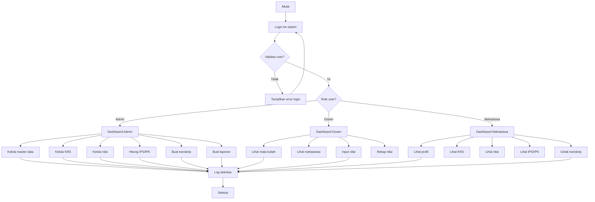
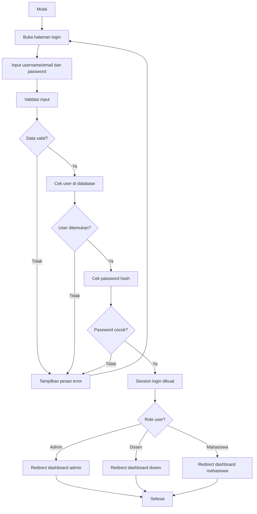
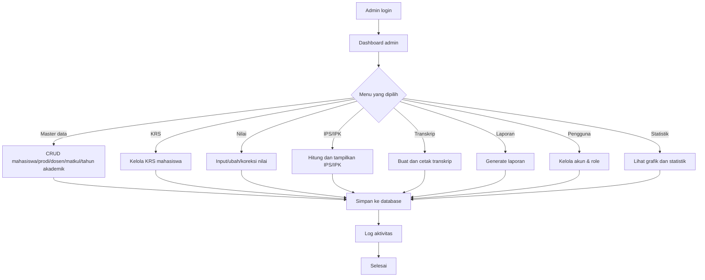
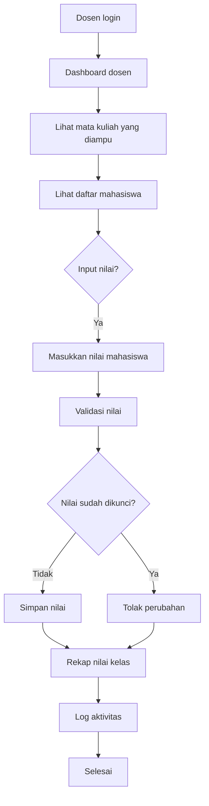
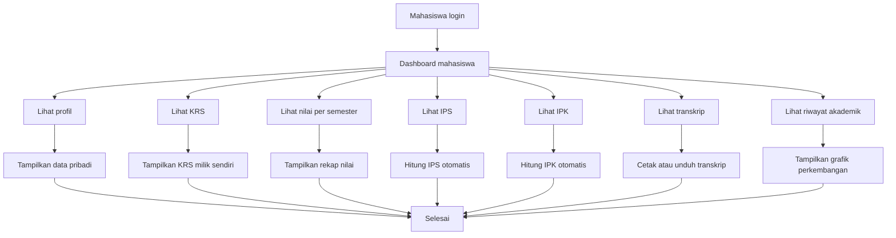
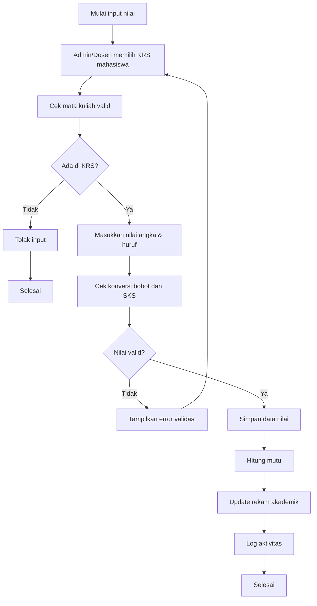
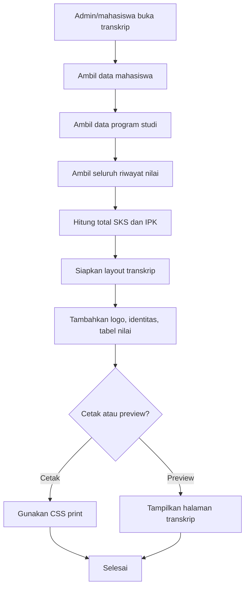
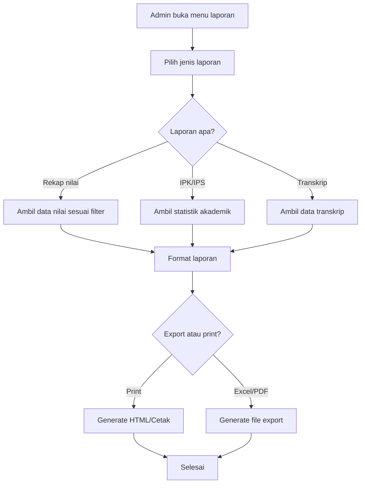

# 2. Flowchart Sistem

## 2.1 Flowchart keseluruhan sistem



## 2.2 Flowchart login



## 2.3 Flowchart admin



## 2.4 Flowchart dosen



## 2.5 Flowchart mahasiswa



## 2.6 Flowchart input nilai



## 2.7 Flowchart perhitungan IPS

```mermaid
flowchart TD
    A[Mulai hitung IPS] --> B[Pilih semester tertentu]
    B --> C[Ambil mata kuliah dan nilai mahasiswa]
    C --> D[Filter data sesuai semester]
    D --> E[Ambil bobot nilai dari tabel konfigurasi]
    E --> F[Hitung total mutu = Σ(SK S × bobot)]
    F --> G[Hitung total SKS]
    G --> H{Total SKS > 0?}
    H -- Tidak --> I[IPS = 0]
    H -- Ya --> J[IPS = total mutu / total SKS]
    I --> K[Simpan/hasil tampilkan]
    J --> K
    K --> L[Selesai]
```

## 2.8 Flowchart perhitungan IPK

```mermaid
flowchart TD
    A[Mulai hitung IPK] --> B[Ambil semua mata kuliah yang lulus dan tertulis dalam nilai]
    B --> C[Validasi data akademik]
    C --> D[Ambil bobot setiap nilai]
    D --> E[Hitung total mutu = Σ(SKS × bobot)]
    E --> F[Hitung total SKS keseluruhan]
    F --> G{Total SKS > 0?}
    G -- Tidak --> H[IPK = 0]
    G -- Ya --> I[IPK = total mutu / total SKS]
    H --> J[Tampilkan hasil IPK]
    I --> J
    J --> K[Selesai]
```

## 2.9 Flowchart pembuatan transkrip



## 2.10 Flowchart laporan


