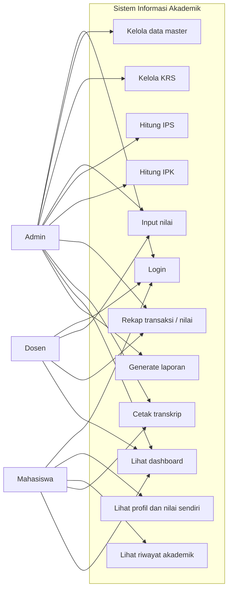
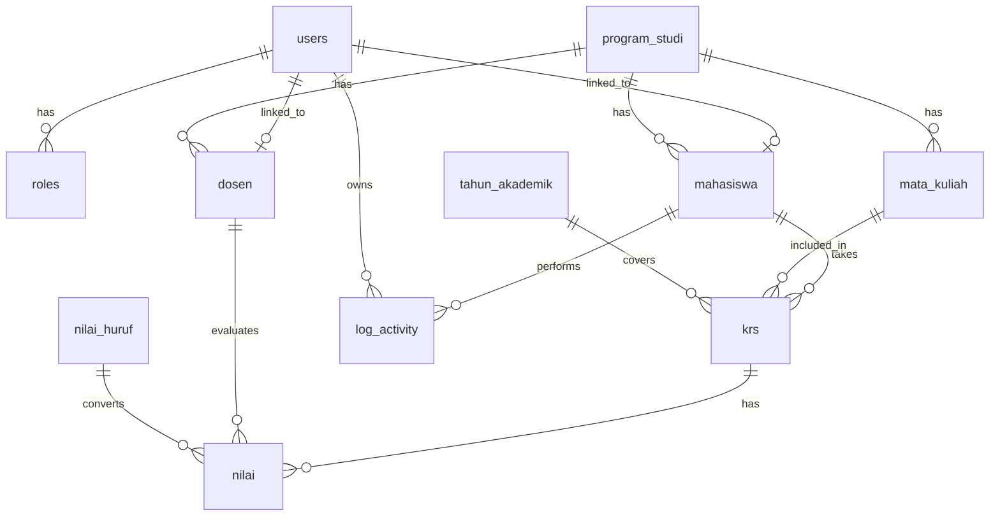

# 3. Use Case dan ERD Awal

## 3.1 Use Case Diagram

## 3.2 Penjelasan use case

### Admin
- Login ke sistem
- Mengelola data mahasiswa, dosen, prodi, matakuliah, tahun akademik, semester
- Mengelola KRS mahasiswa
- Menginput, mengubah, dan melihat nilai
- Menghitung IPS/IPK dan menghasilkan rekap
- Menampilkan dan mencetak transkrip
- Mengelola akun pengguna dan role
- Menyusun laporan dan export data

### Dosen
- Login ke sistem
- Melihat data mata kuliah yang diampu
- Melihat daftar mahasiswa dalam kelas
- Menginput dan mengedit nilai sebelum dikunci
- Melihat rekap nilai kelas
- Melihat statistik nilai mata kuliah

### Mahasiswa
- Login ke sistem
- Melihat profil dan data diri
- Melihat KRS yang diambil
- Melihat nilai dan IPS per semester
- Melihat IPK kumulatif
- Melihat transkrip
- Melihat riwayat akademik
- Mencetak transkrip jika diizinkan

## 3.3 ERD awal

## 3.4 Struktur database awal

### Tabel utama
- users
- roles
- mahasiswa
- dosen
- program_studi
- mata_kuliah
- tahun_akademik
- semester
- krs
- nilai
- nilai_huruf
- log_activity

### Field utama

#### users
- id
- username
- email
- password
- role_id
- status
- created_at
- updated_at

#### roles
- id
- nama_role
- keterangan

#### mahasiswa
- id
- nim
- nama
- jenis_kelamin
- tempat_lahir
- tanggal_lahir
- alamat
- email
- no_hp
- program_studi_id
- angkatan
- status
- user_id

#### dosen
- id
- nidn
- nama
- email
- no_hp
- program_studi_id
- status
- user_id

#### program_studi
- id
- kode_prodi
- nama_prodi
- jenjang
- status

#### mata_kuliah
- id
- kode_mk
- nama_mk
- sks
- semester
- jenis_mk
- program_studi_id
- status

#### tahun_akademik
- id
- tahun_akademik
- semester
- status_aktif

#### krs
- id
- mahasiswa_id
- mata_kuliah_id
- tahun_akademik_id
- semester
- status

#### nilai
- id
- krs_id
- dosen_id
- nilai_angka
- nilai_huruf
- bobot
- sks
- semester
- tahun_akademik_id
- status_kelulusan
- created_at
- updated_at

#### nilai_huruf
- id
- kode
- nilai_huruf
- bobot
- status

#### log_activity
- id
- user_id
- aktivitas
- modul
- waktu
- ip_address
- data_terkait

## 3.5 Relasi dan normalisasi
- User memiliki satu role.
- Mahasiswa memiliki satu program studi.
- Dosen memiliki satu program studi.
- Mata kuliah dimiliki oleh satu program studi.
- KRS mewakili matakuliah yang dipilih mahasiswa pada semester tertentu.
- Nilai mengacu ke KRS, dosen, dan konversi nilai huruf.
- Semua tabel master dilengkapi timestamp dan status.

## 3.6 Prinsip validasi data awal
- NIM unik
- Kode mata kuliah unik
- KRS tidak boleh duplikat per semester
- Nilai hanya diberikan pada KRS yang valid
- Nilai huruf dan bobot diambil dari konfigurasi, bukan hardcode tersebar
